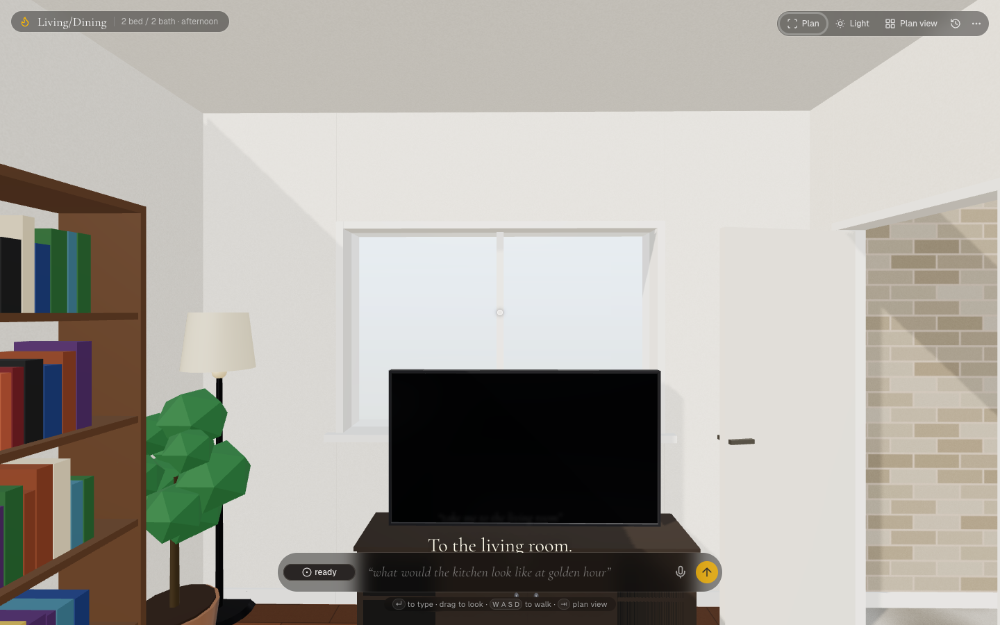
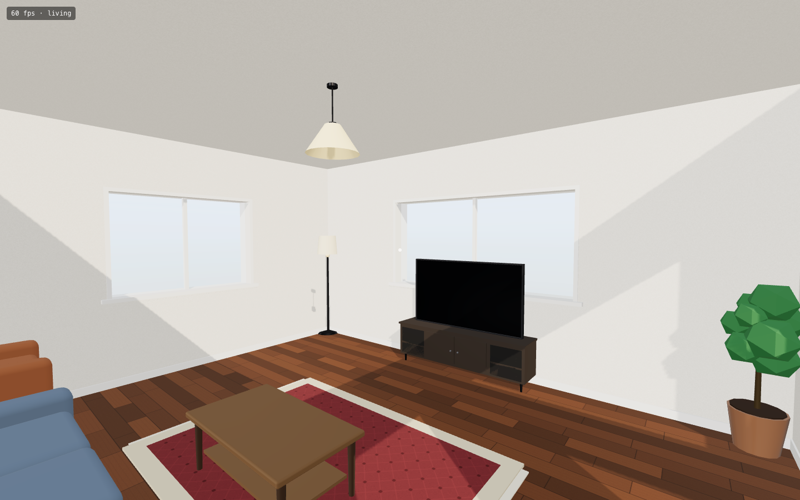
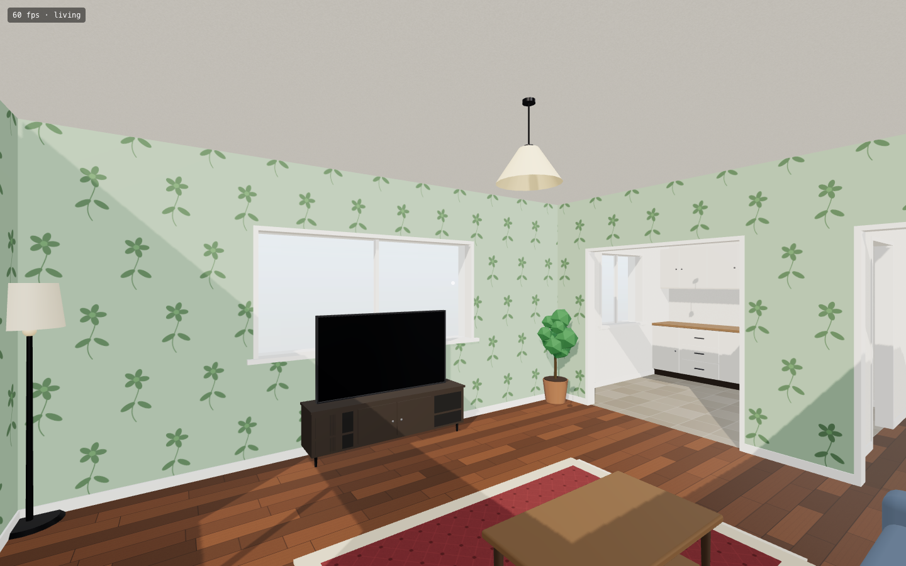
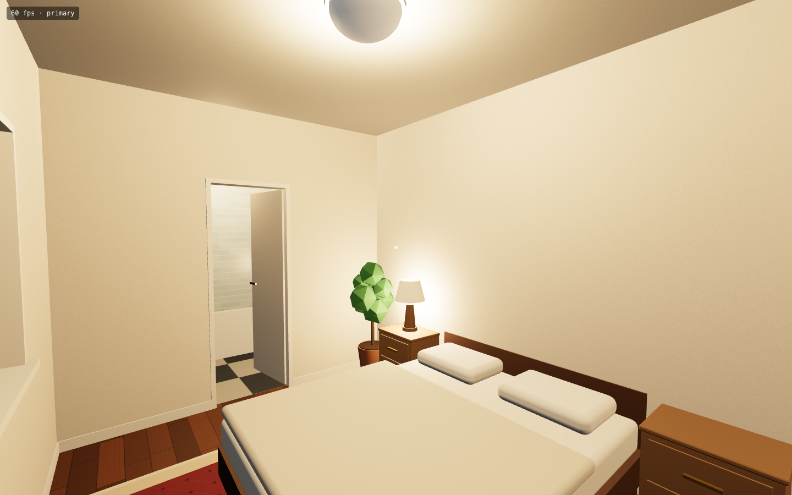
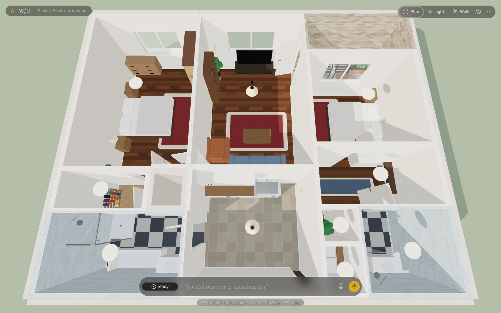
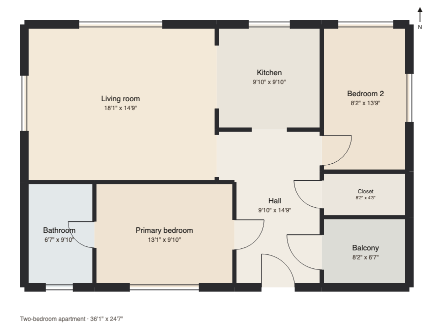

# Instant Interiors

**Paste a floor plan. Walk through it. Change it by talking.**

Instant Interiors turns a floor-plan image into a first-person 3D home in about eight seconds, then lets
you redesign it in plain English: "move the sofa under the window", "wallpaper the bedroom in a soft
green floral", "what does the kitchen look like at golden hour". A fast model turns each sentence into a
few small JSON ops and a deterministic engine places, paints and lights, streaming each change into the
room you are standing in before the model has finished its sentence.



## What it does

| | |
|---|---|
|  |  |
| **Walk it.** WASD and drag to look, 1.6 m eye height, real sun through the windows that follows the time of day and the plan's north. | **Say it.** "wallpaper this room in a soft green floral" became one `surface` op; the pattern is drawn procedurally and tiles around the window. |
|  |  |
| **Light it.** "it's night, lamps on" switches the sun off and lights the nearest lamps with real point lights, warmth adjustable. | **See it whole.** Tab flips to a dollhouse view. This home was read from a real 2 bed / 2 bath listing screenshot: ten rooms, both bedrooms within 3 % of their labelled areas. |

Things you can say (all covered by the sentence bench and the QA tour):

- "put a round table with four chairs in the kitchen", "swap the sofa for a green velvet sectional"
- "paint the living room a warm terracotta", "make all the floors light oak herringbone"
- "golden hour", "it's too dark in here", "furnish bedroom 2 scandinavian", "take me to the kitchen", "undo"

## Try it

Requires Node 22 and a [Vercel AI Gateway](https://vercel.com/ai-gateway) key; both models are called
through the gateway.

```bash
git clone https://github.com/GKjohns/instant-interiors.git && cd instant-interiors
npm install
cp .env.example .env   # set AI_GATEWAY_API_KEY
npm run dev            # http://localhost:3092
```

A drawn two-bedroom sample loads on first visit, so there is a home to walk right away. To read a plan,
paste a floor-plan screenshot anywhere on the page, drop a file, or open the Plan panel. The repo ships test
plans in `public/samples/` (`two_bedroom_apartment.png` plus three Wikimedia Commons plans, credited in
`SOURCES.md`). The listing screenshot used for the dollhouse shot above, `public/samples/desktop_2br.png`,
is not committed; put any listing screenshot at that path to use it in the benches. A one-line hint such as
"2 bedroom apartment, dimensions in feet" makes reads noticeably more stable.

Controls: WASD to walk (shift runs), drag to look, double-click to lock the mouse. Enter focuses the bar,
Tab flips walk and plan view, Cmd-Z undoes the last sentence. The home saves to localStorage; export and
import JSON from the menu.

## How it works



**Image to plan.** Sonnet 5.5 vision reads the image with structured output into rooms as polygons in
metres, with doors and windows attached to the rooms they join (`server/utils/planExtract.ts`). Two reads
run side by side and a deterministic scorer keeps the better one (`shared/plan/score.ts`). `normalizePlan`
turns the loose shape a model writes (feet or metres, sloppy corners, slivers between rooms) into a strict
plan. Walls are derived, never stored, so two rooms that share an edge share one wall, and an open-plan
boundary gets no wall at all.

**Plan to home.** The renderer (`app/home/`, three.js) builds the shell from the plan, with wall pieces cut
for doors and windows, 70 hand-built low-poly furniture kinds, 13 procedural wall and floor patterns, a sun
that follows the time of day and the plan's north, real point lights for the nearest lamps, and a plan view.

**Sentence to ops.** Haiku 5.5 turns each sentence into a few small JSON ops (`shared/home/ops.ts`):
`place | move | remove | restyle | surface | light | furnish | goto | undo | reset | say`. Models never do
coordinate math. A place is a Spot ("against the north wall of the living room", "beside the sofa", "where
I'm looking"), and ops stream back as NDJSON as each JSON object closes (`server/utils/intent.ts`).

**Ops to room.** A pure TypeScript kernel with no three.js (`shared/home/`) resolves every Spot into metres,
seeded by the sentence so results are repeatable. It keeps pieces inside rooms, off door swings, out of
each other and out of walkways, carries a bed's nightstands and lamps when the bed moves, and returns plain
notes for what did not fit. The op log is the source of truth: undo, reload, export and import all replay it
over the plan.

**Speed and cost.** Sentences: about 0.8 s to the first change and about $0.0002 each, 70/70 on the
bench (35 sentences on each of two homes). Reading a plan: 6 to 9 s and about $0.02. The renderer holds 60 fps on a laptop.

This is the architecture of [Conjure](https://github.com/GKjohns/voice-world) (speak a 3D world into
existence) pointed at interior design. Floor-plan-to-3D tools exist and conversational photo redesign
exists; as of October 2026 I found nothing that ships the full loop of reading a plan and then editing the
live 3D room in plain English.

Commands, code layout and benchmark notes are in [docs/DEVELOPMENT.md](docs/DEVELOPMENT.md).

## Known limits

Plan reads still fold small closets (W/D, mech) into the hall about half the time, and reads without a hint
are less stable. Tight rooms refuse a piece rather than block a walkway, so a small kitchen may seat only
one or two chairs at a round table. Floor pieces can sink a few centimetres into walls. Not here yet:
realtime voice (the browser mic works where SpeechRecognition exists), wall edits ("put a door here"),
furniture collision while walking, a shoppable catalog.
